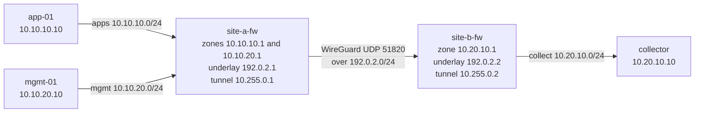

# Topology

Draft for the first checkpoint. The empty containerlab file is `topology.clab.yml`. It creates the nodes and addresses below, and does not configure the tunnel or nftables.

## Picture

## Address plan

| Place | Subnet | Address | Role |
| --- | --- | --- | --- |
| Site A apps | `10.10.10.0/24` | `.1` gateway, `.10` app-01 | Zone. No path to Site B. |
| Site A mgmt | `10.10.20.0/24` | `.1` gateway, `.10` mgmt-01 | Zone. No path to Site B or to apps. |
| Site B collect | `10.20.10.0/24` | `.1` gateway, `.10` collector | rsyslog listens on TCP 514. |
| Untrusted underlay | `192.0.2.0/24` | `.1` site-a-fw, `.2` site-b-fw | Simulated untrusted link. RFC 5737. |
| Tunnel | `10.255.0.0/30` | `.1` site-a-fw, `.2` site-b-fw | WireGuard. Carries the log flow only. |

Site A summary route: `10.10.0.0/16`. Site B summary route: `10.20.0.0/16`. Each firewall's WireGuard `AllowedIPs` is the other site's summary, not `0.0.0.0/0`.

## Path a firewall log takes

1. A packet hits `site-a-fw` and nftables decides allow or drop.
2. The matching rule writes a prefixed log line in the kernel log.
3. rsyslog on `site-a-fw` reads that prefix and forwards it with TCP to `10.20.10.10:514`.
4. The TCP session is sourced from `10.255.0.1` and enters `wg0`.
5. WireGuard encrypts it and sends UDP `51820` to `192.0.2.2`.
6. `site-b-fw` decrypts, and its forward rules permit only that TCP session to the collector.
7. The collector appends the line to a file on disk.

`app-01` and `mgmt-01` are not on this path. They exist so the zones are real networks, and so a denied cross-zone packet can generate a log that shows up at Site B.

## What "working" looks like

- From `site-a-fw`, a TCP connection to `10.20.10.10:514` succeeds. The same connection to any other Site B port fails.
- From `app-01`, both the collector and `mgmt-01` are unreachable.
- The collector file contains a line that was produced by the Site A firewall.
- `ss` or an equivalent check shows no lab service listening on a published host port.
