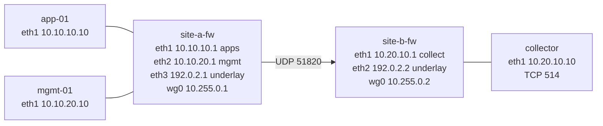

# Topology

Checked on 2026-11-06 in Codespace `hm-net`. `topology.clab.yml` creates the five nodes, the four lab links, and the addresses on those links. `scripts/bringup-core.sh` adds the host routes, the WireGuard tunnel, the drop policy, and the log path.

The ping from `app-01` to `mgmt-01` does not cross the tunnel. The firewall drops it on Site A. A copy of that drop is what crosses the tunnel and lands in `/var/log/site-a.log`.

## Picture

Every node also has `eth0` on containerlab's management network `172.20.20.0/24`. That network is how packages are installed. It is not drawn above because it is not a path from Site A to Site B. No lab port is published on the Codespace.

## Where each address sits

| Node | Interface | Address | Connects to |
| --- | --- | --- | --- |
| `app-01` | eth1 | `10.10.10.10/24` | `site-a-fw` eth1 |
| `mgmt-01` | eth1 | `10.10.20.10/24` | `site-a-fw` eth2 |
| `site-a-fw` | eth1 | `10.10.10.1/24` | apps zone gateway |
| `site-a-fw` | eth2 | `10.10.20.1/24` | mgmt zone gateway |
| `site-a-fw` | eth3 | `192.0.2.1/24` | `site-b-fw` eth2 |
| `site-a-fw` | wg0 | `10.255.0.1/30` | WireGuard, created by the script |
| `site-b-fw` | eth1 | `10.20.10.1/24` | collector gateway |
| `site-b-fw` | eth2 | `192.0.2.2/24` | `site-a-fw` eth3 |
| `site-b-fw` | wg0 | `10.255.0.2/30` | WireGuard, created by the script |
| `collector` | eth1 | `10.20.10.10/24` | `site-b-fw` eth1 |
| every node | eth0 | `172.20.20.0/24` | containerlab management, assigned by Docker |

The underlay is not the same interface number on both firewalls. Site A uses `eth3`. Site B uses `eth2`. The nftables rules use those names.

## Routes the script adds

`topology.clab.yml` does not add these. `scripts/bringup-core.sh` does.

| Node | Route | Why |
| --- | --- | --- |
| `app-01` | `10.10.20.0/24` and `10.20.0.0/16` via `10.10.10.1` | So a packet to the other zone actually reaches the firewall. Without the route, the firewall never sees it and cannot log a drop. |
| `mgmt-01` | `10.10.10.0/24` and `10.20.0.0/16` via `10.10.20.1` | Same, in the other direction. |
| `site-a-fw` | `10.20.0.0/16` dev `wg0` | Collector subnet goes into the tunnel. |
| `site-b-fw` | `10.10.0.0/16` dev `wg0` | Site A summary comes out of the tunnel. |
| `collector` | `10.255.0.0/30` via `10.20.10.1` | Reply to the firewall's tunnel address. Without this, the reply would leave through `eth0`. |

WireGuard `AllowedIPs` is not `0.0.0.0/0`.

- On `site-a-fw`, the peer may send `10.20.0.0/16` and `10.255.0.2/32`.
- On `site-b-fw`, the peer may send `10.10.0.0/16` and `10.255.0.1/32`.

The `/32` entries are the two tunnel addresses. A ping to `10.255.0.2` fails with "Required key not available" if `10.255.0.2/32` is missing. The log itself is sourced from `10.255.0.1`, so Site B must allow that address too.

When `wg0` is set down, the route `10.20.0.0/16 dev wg0` disappears. `ip link set wg0 up` does not put it back. The repair is `ip route replace 10.20.0.0/16 dev wg0`.

## Path of the demo

1. `app-01` sends an ICMP echo to `10.10.20.10`. Its route sends that packet to `10.10.10.1`.
2. The packet enters `site-a-fw` on `eth1`. The next hop would be `eth2`.
3. The forward chain logs that pair, `10.10.10.0/24` to `10.10.20.0/24`, with NFLOG group 1 and prefix `hm-site-a`. The rule does not accept the packet. The chain policy is drop, so the ping dies here. `mgmt-01` never sees it.
4. ulogd on `site-a-fw` reads NFLOG group 1 and appends the line to `/var/log/nft.log`. This is not the Codespace kernel log. A plain nftables `log`, without a group, would land in that shared kernel buffer instead of in this container.
5. rsyslog on `site-a-fw` reads `/var/log/nft.log` and sends it with TCP to `10.20.10.10` port `514`. The firewall's route sends that connection out `wg0`, sourced from `10.255.0.1`.
6. WireGuard encrypts the TCP session and carries it as UDP `51820` from `192.0.2.1` to `192.0.2.2`.
7. `site-b-fw` decrypts it. The forward rule allows that flow only: in on `wg0`, out on `eth1`, source `10.255.0.1`, destination `10.20.10.10`, TCP `514`.
8. The collector accepts it on `10.20.10.10:514` and appends `/var/log/site-a.log`. Its route for `10.255.0.0/30` sends the TCP reply back to `site-b-fw`.

Other drops are silent. Only the apps-to-mgmt pair is logged.

## What was observed

- Ping from `app-01` to `10.10.20.10`: 100% loss.
- Ping from `app-01` to `10.20.10.10`: 100% loss.
- TCP from `site-a-fw` to `10.20.10.10` port `514`: succeeds.
- TCP from `site-a-fw` to `10.20.10.10` port `22`: times out.
- `/var/log/site-a.log` contains `hm-site-a`, `SRC=10.10.10.10`, `DST=10.10.20.10`.
- With `wg0` down, `/var/log/nft.log` still grows and `/var/log/site-a.log` does not.
